# Modernizing to PaaS and Securing Secrets in Azure

A database server that you patch, back up and keep running yourself is work the business pays for every month. A managed database does that work for you. This lab replaces the self-managed database server from Lab 02 with Azure SQL Database, then stores the database password in Azure Key Vault and lets the web server read it with its own identity, so no password sits in code or on the server.

This lab builds on [Lab 02](https://github.com/dmill1mb/azure-2-tier-web-lab). It needs the web server `vm-web-01` from that lab to be running.

You do not need any Azure experience to follow this. Each step says what it does, what to do, and what you should see when it works.

## What this lab is for

- **Retire a server you manage:** delete the database virtual machine and its leftovers.
- **Use a managed database instead:** create an Azure SQL Database and see what Azure takes care of.
- **Keep a password out of code:** store it in Key Vault as a secret.
- **Give a server an identity:** turn on a managed identity for the web server, so it proves who it is without a password.
- **Grant only what is needed:** give that identity read-only access to secrets.
- **Prove it works:** read the secret from the web server using only its identity.

## Words you will see

| Word | What it means here |
|---|---|
| IaaS (Infrastructure as a Service) | You rent a virtual machine and manage everything on it. Lab 02 did this. |
| PaaS (Platform as a Service) | You use a service and Azure manages the machines under it. This lab does this. |
| Azure SQL Database | A managed database based on Microsoft SQL Server. Azure handles the operating system, patching and backups. |
| SQL server (in Azure) | A logical container that holds the admin login, firewall rules and region for one or more databases. It is not a virtual machine. |
| DTU (Database Transaction Unit) | One number that combines processing, memory and disk speed. The Basic tier gives 5 DTUs. |
| Key Vault | An Azure service for storing secrets, keys and certificates. |
| Secret | A sensitive value, such as a password, stored in Key Vault. |
| Managed identity | An identity Azure creates and looks after for a resource, such as a virtual machine. The resource uses it to sign in to other Azure services with no password. |
| RBAC (role-based access control) | Azure's permission system. You assign a role to an identity on a resource. |
| IAM (Identity and Access Management) | The page on each Azure resource where you see and change who has which role. |
| Least privilege | Giving an identity only the permissions it needs and nothing more. |
| IMDS (Instance Metadata Service) | A local address, `169.254.169.254`, that a virtual machine can ask for its own details and for its identity token. It is reachable only from inside the machine. |
| Soft delete | A Key Vault keeps a deleted vault for a retention period, and the name stays reserved until the period ends or the vault is purged. |

## Architecture

```
  rg-lab02-<yourname>                  rg-lab03-<yourname>
+---------------------------+          +----------------------------------------+
|  vm-web-01                |          |  Key Vault: kv-lab03-<yourname>        |
|  managed identity: ON     |--------->|  secret: SqlAdminPassword              |
|                           |          +----------------------------------------+
|                           |          +----------------------------------------+
|                           |--------->|  SQL server: sql-server-<yourname>     |
+---------------------------+          |  database: sqldb-app (Basic)           |
                                       +----------------------------------------+
  vm-db-01: deleted
```

## Lab variables

| Item | Value |
|---|---|
| Lab 02 resource group | `rg-lab02-<yourname>` |
| Lab 03 resource group | `rg-lab03-<yourname>` |
| SQL server | `sql-server-<yourname>`, all lowercase, unique across Azure |
| SQL database | `sqldb-app` |
| SQL admin login | `sqladmin` |
| Key Vault | `kv-lab03-<yourname>`, unique across Azure |
| Secret | `SqlAdminPassword` |
| Region | Central US, the same as Lab 02. Any region works if you keep to one. |

## What's inside

```
Modernize-to-SQL-PaaS/
  README.md      this file
  images/        screenshots from the lab, with IDs blacked out
  .gitignore     keeps keys and secrets out of Git
```

## Before you start

- An Azure subscription and permission to create resources in it.
- `vm-web-01` running in `rg-lab02-<yourname>`, from Lab 02. If you deleted Lab 02, build it again first. Step 2 also deletes `vm-db-01`, so it needs to exist.
- The Azure CLI installed, to run the checks.
- A password manager or a safe place to keep one password you are about to create.

Steps 3 to 11 were run from start to finish in Central US, and the screenshots come from that run. Steps 1 and 2 were not run, because the test build skipped `vm-db-01`. They are written from the lab instructions.

Sign in first, and do it again in any new terminal:

```powershell
az login
```

## Use your own name, not mine

Wherever you see `<yourname>`, replace it with your own name or a short handle, and leave out the angle brackets. If you type `<yourname>` into a terminal as it is, PowerShell reads the `<` as a file redirect and fails. Two names must be unique across all of Azure: the SQL server and the Key Vault. Both become public host names. If Azure says a name is taken, add a few digits to the end.

Run every `az` command in a terminal on your own computer. The only commands that run on the web server are in Step 9.

Never put the SQL password in this repository, in a screenshot, or in a command you paste into a document.

## Step 1: Check the starting point

**What this step does.** It confirms the Lab 02 servers exist before you change them.

**What to do.** Run:

```powershell
az vm list -g rg-lab02-<yourname> -d -o table
```

**What you should see.** `vm-web-01` and `vm-db-01`, both `VM running`.

## Step 2: Delete the database server

**What this step does.** It removes the server the managed database replaces. Deleting the virtual machine alone leaves its disk and network interface behind, and the disk keeps billing.

**What to do.** In the portal, open `rg-lab02-<yourname>`. Select these three resources and click **Delete**:

- the virtual machine `vm-db-01`
- its OS disk, named like `vm-db-01_OsDisk_...`
- its network interface, named like `vm-db-01...`

Do not delete the resource group or anything for `vm-web-01`. If you are unsure which disk or interface is which, open each one and read the VM name on its Overview page.

**What you should see.** List what is left from Azure:

```powershell
az resource list -g rg-lab02-<yourname> -o table
```

No resource has `vm-db-01` in its name. The `vm-web-01` resources are still there.

## Step 3: Create the SQL database

**What this step does.** It creates the SQL server container and the database inside it, in one wizard.

**What to do.** In the portal, search for **SQL databases**. Click the arrow next to **Create** and choose **SQL database**, not the free offer. If a green banner says the free offer is applied, remove it first, with the button on the banner (it can say **Remove offer** or **Advanced configuration**). While it is applied, the DTU Basic tier does not show. No banner appeared in the test run, and the DTU-based option was available, so you may not see one.

Use your own name in every name below, the same as in Lab 02, and leave out the angle brackets. For example, if your name is Jordan, the server is `sql-server-jordan`. The server name becomes a public host name (`sql-server-jordan.database.windows.net`), so it must be unique across all of Azure. If Azure says it is taken, add a few digits to the end.

On the Basics tab:

- Resource group: create new, `rg-lab03-<yourname>`
- Database name: `sqldb-app`. Clear any name the portal filled in. This is the database name, not the server name.
- Server: click **Create new**, then use:
  - Server name: `sql-server-<yourname>`
  - Location: Central US
  - Authentication method: **Use SQL authentication**
  - Server admin login: `sqladmin`
  - Password: a long random password. Save it in your password manager now. You need it in Step 6.
- Want to use SQL elastic pool: No
- Workload environment: Development. It only sets the starting defaults for the settings below, so check Compute + storage whichever one you pick.
- Compute + storage: it starts on **General Purpose Serverless**, even under Development. Click **Configure database**, choose the **DTU-based** purchasing model, select **Basic**, and click **Apply**. The box then reads Basic with 2 GB of storage, and the cost summary shows 5 DTUs at $0.98 each, an estimated $4.90 a month.
- Backup storage redundancy: Locally-redundant backup storage. It was already selected.

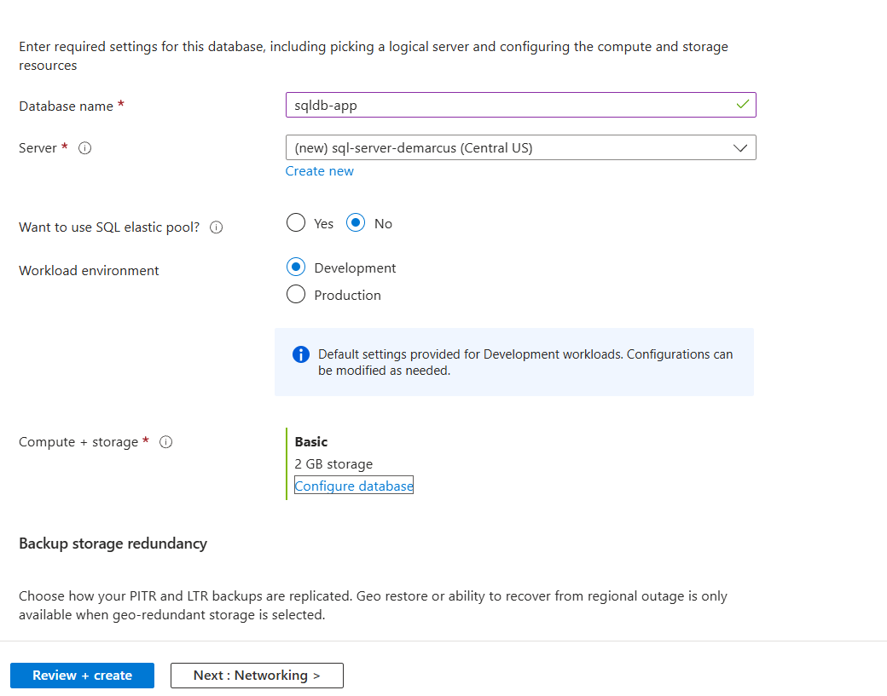

On the Networking tab, the connectivity method starts on **No access**, which means nothing can reach the server.

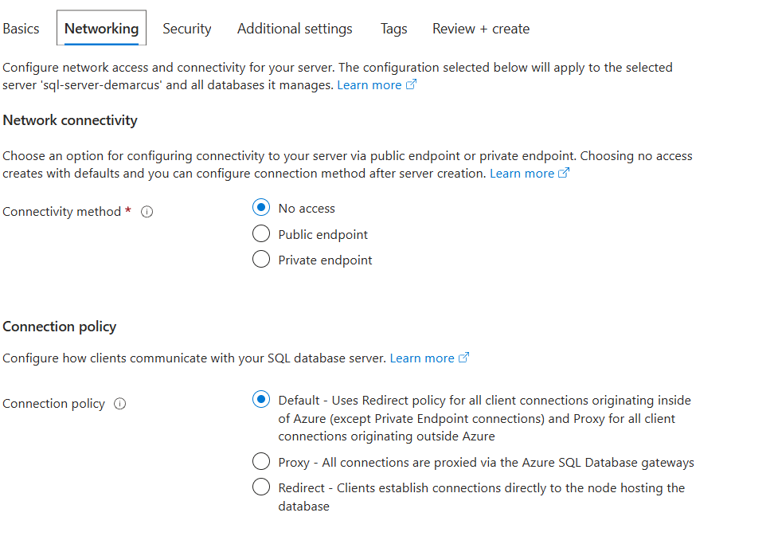

Change these settings:

- Connectivity method: **Public endpoint**. Two firewall toggles appear, both set to No. The cost summary beside them shows Basic at an estimated $4.90 a month.
- Allow Azure services and resources to access this server: Yes. This lets in any resource inside Azure, including resources that belong to other customers. The SQL login is all that stops them.
- Add current client IP address: Yes. This adds the public address of the network you are on to the server firewall, so it does not follow you to a different network.
- Connection policy: leave it on Default.
- Minimum TLS version: leave it at TLS 1.2 if the tab shows this setting. It was not on the part of the page captured in the test run.

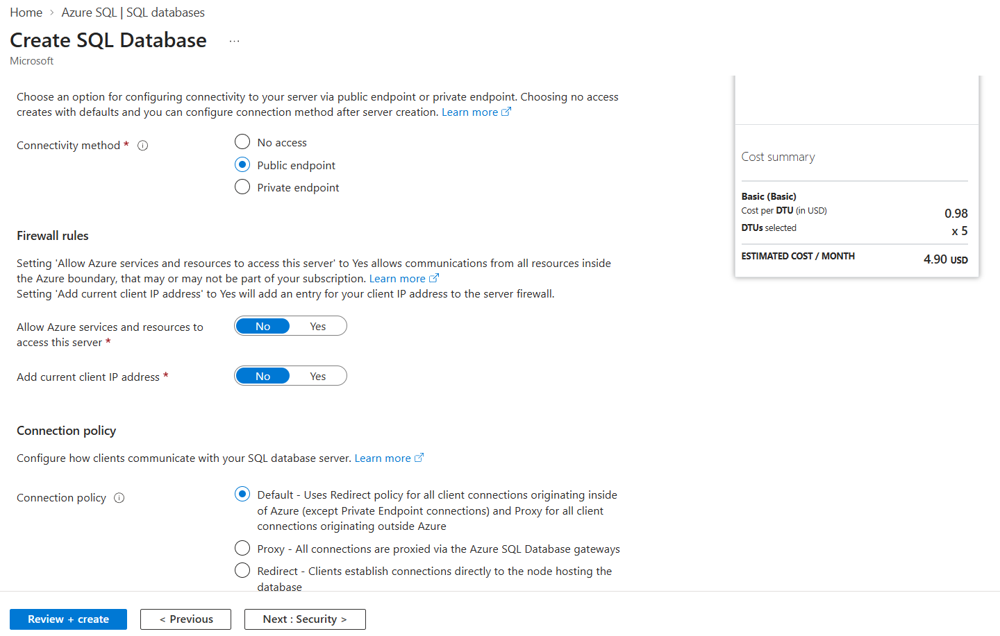

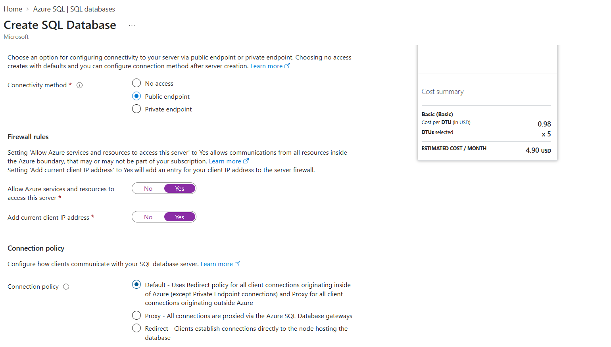

**In a real environment, use a private endpoint.** This lab uses a public endpoint with firewall rules because it is the simplest setup to build and check. A private endpoint gives the SQL server a private IP address inside your virtual network, so only resources in that network, or connected to it, can reach it. You would then turn public network access off completely. This lab skips it because it needs extra resources, such as a private DNS zone, and adds cost.

On the Security tab, make sure Microsoft Defender for SQL is set to **Not now**. The tab says it is free for 30 days and then costs $15 per server per month. Not now was already selected. Leave Ledger on Not configured and Server identity on Not enabled. The server identity here belongs to the SQL server and not to `vm-web-01`.

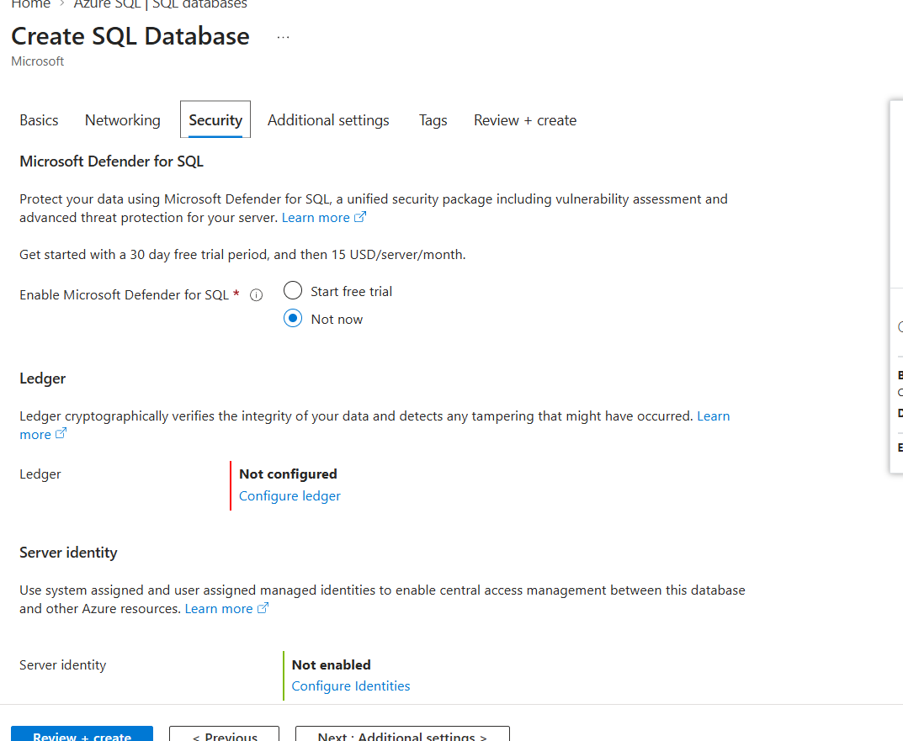

On the Additional settings tab, leave Use existing data on None, which gives a blank database, and leave the collation and maintenance window at their defaults. Skip the Tags tab.

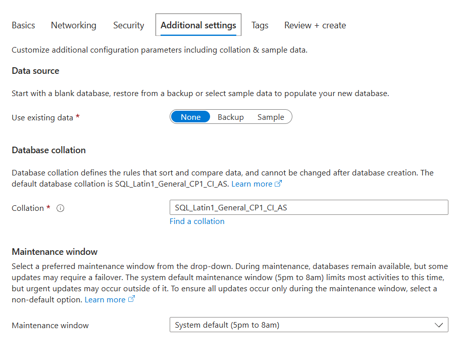

Click **Review + create**, check that the tier says Basic and the names are right, then click **Create**. It takes a few minutes.

**What you should see.** Check the database from Azure and not from the form:

```powershell
az sql db show -g rg-lab03-<yourname> -s sql-server-<yourname> -n sqldb-app --query status -o tsv
az sql db show -g rg-lab03-<yourname> -s sql-server-<yourname> -n sqldb-app --query currentSku.name -o tsv
```

The first prints `Online` and the second prints `Basic`.

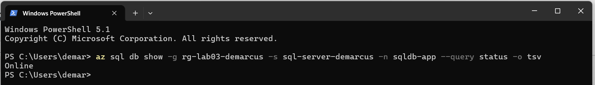

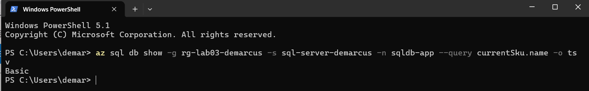

## Step 4: Create the Key Vault

**What this step does.** It creates the safe place for the password.

**What to do.** In the portal, search for **Key vaults** and click **Create**. On the Basics tab:

- Resource group: `rg-lab03-<yourname>`
- Key vault name: `kv-lab03-<yourname>`
- Region: Central US
- Pricing tier: Standard
- Purge protection: leave it disabled. If you enable it, you cannot delete the vault for good when you clean up.
- Soft delete is always on, with 90 days of retention. You cannot turn it off.

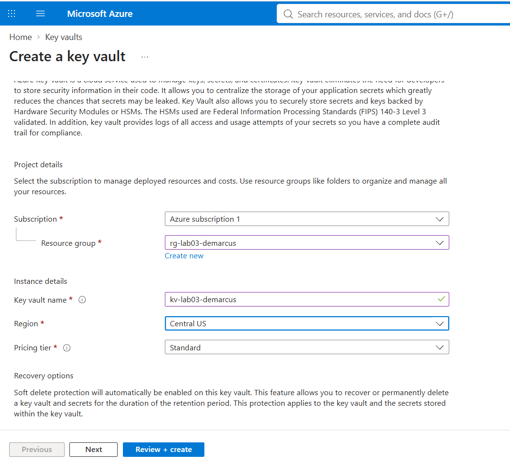

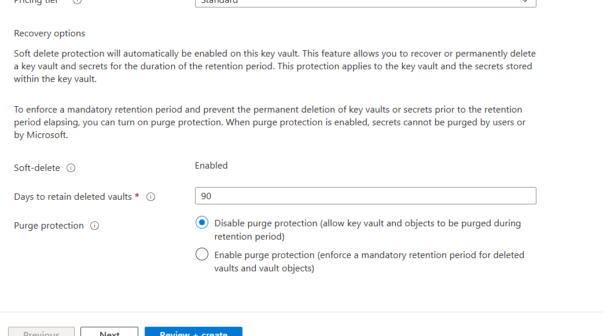

On the Access configuration tab, keep **Azure role-based access control**. Leave the three resource access boxes unchecked.

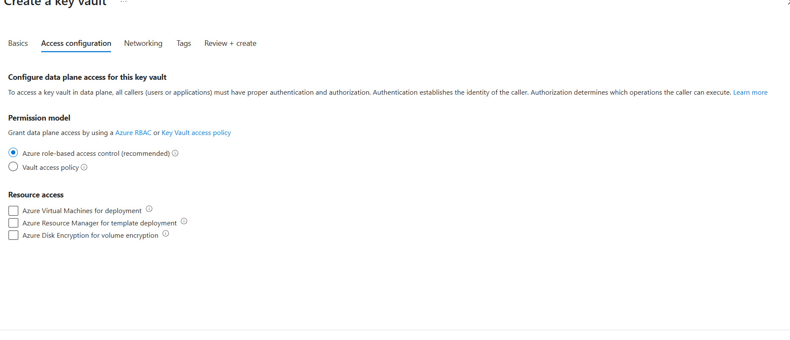

On the Networking tab, leave public access on for all networks. The portal warns that this is not recommended for private applications or environments. That is acceptable for a lab. A real environment would use the **Create a private endpoint** button on this tab instead.

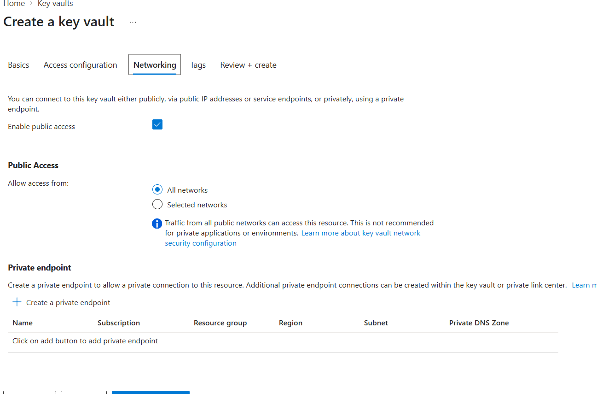

Skip the Tags tab. Click **Review + create**, check the names and settings, then click **Create**.

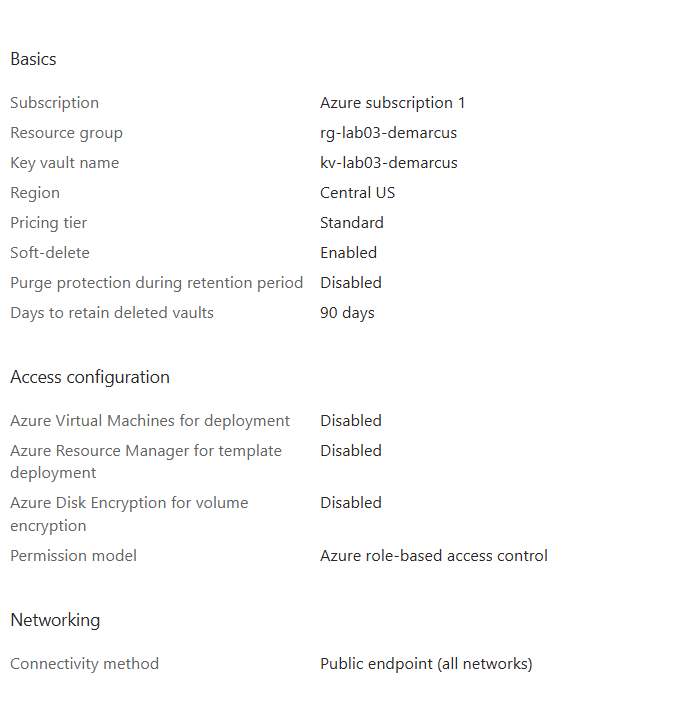

**What you should see.** The vault's Overview page shows a Vault URI like `https://kv-lab03-<yourname>.vault.azure.net/`.

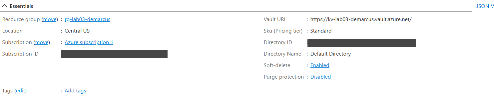

Then confirm it uses role-based access:

```powershell
az keyvault show -n kv-lab03-<yourname> --query properties.enableRbacAuthorization -o tsv
```

It prints `true`.

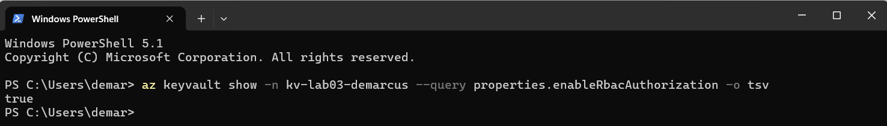

## Step 5: Give yourself access to the vault

**What this step does.** It gives your own account permission to create secrets. With role-based access, nobody has access by default, including the person who created the vault.

**What to do.** First see the problem. In the Key Vault, open **Objects**, then **Secrets**. The page says "The operation is not allowed by RBAC" and "You are unauthorized to view these contents."

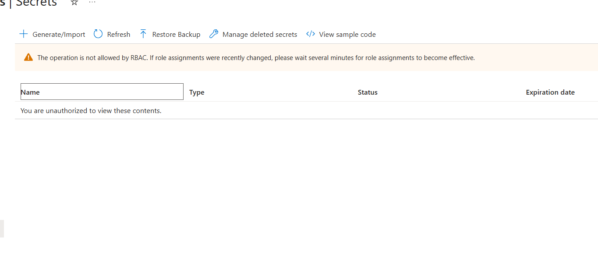

Now fix it. Open **Access control (IAM)**, click **Add**, then **Add role assignment**. On the Role tab pick **Key Vault Secrets Officer**. It can create and read secrets, which is all you need here.

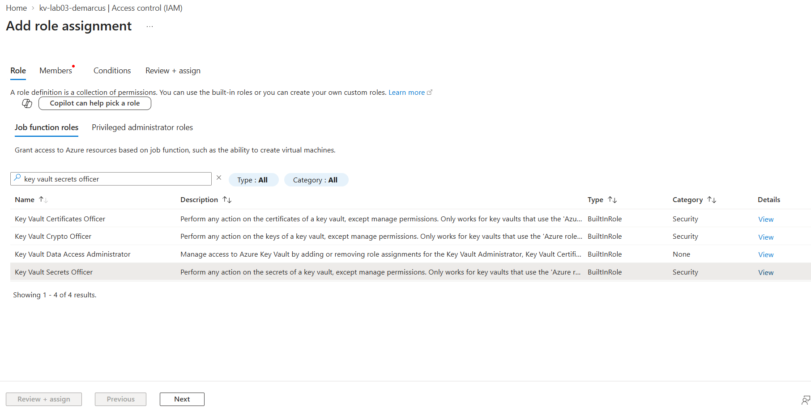

Be careful not to pick **Key Vault Secrets User** for yourself. That role only reads secret values, and Step 6 needs you to create one. **Key Vault Administrator** works too, but it is more than you need. Neither of them is the role for deciding who else gets access. That is **Key Vault Data Access Administrator**.

On the Members tab choose **User, group, or service principal**, select your own account, and complete **Review + assign** twice. Wait one to two minutes.

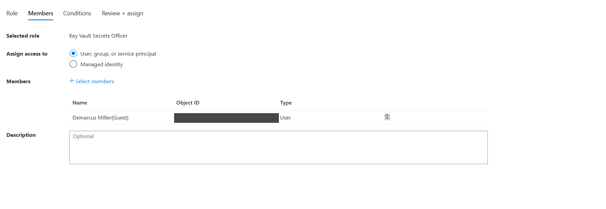

**What you should see.** Refresh the Secrets page. The error is gone, and it reads "There are no secrets available."

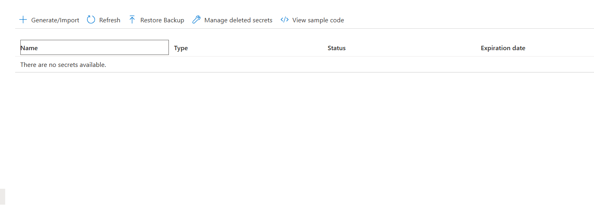

## Step 6: Store the password as a secret

**What this step does.** It puts the SQL password in the vault, so it does not have to live anywhere else.

**What to do.** In **Secrets**, click **Generate/Import** and use:

- Upload options: Manual
- Name: `SqlAdminPassword`
- Secret value: the SQL admin password from Step 3
- Everything else: leave at the defaults

Click **Create**. Never show the secret value. If you screenshot the form, crop out the Secret value row, because the dots show how long the password is.

The Secrets list shows the name and the status, never the value.

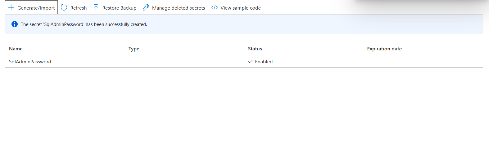

**What you should see.** List the secrets in the vault:

```powershell
az keyvault secret list --vault-name kv-lab03-<yourname> -o table
```

`SqlAdminPassword` is listed. Do not run `az keyvault secret show` here. It prints the password.

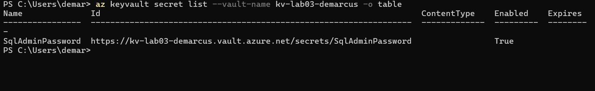

## Step 7: Turn on the web server's managed identity

**What this step does.** It gives `vm-web-01` an identity in Azure that nobody has to look after.

**What to do.** In the portal, open `vm-web-01` in `rg-lab02-<yourname>`. Open **Identity**, stay on the **System assigned** tab, switch **Status** to **On**, click **Save**, and confirm with **Yes**.

**What you should see.** The page shows an Object (principal) ID, and a blue note says the resource is registered with Microsoft Entra ID.

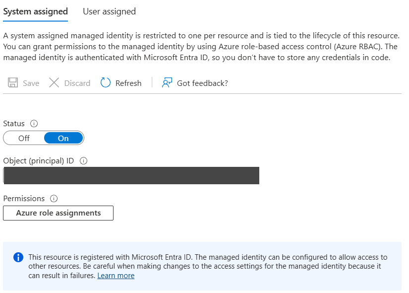

Check from Azure:

```powershell
az vm show -g rg-lab02-<yourname> -n vm-web-01 --query identity.type -o tsv
```

It prints `SystemAssigned`.

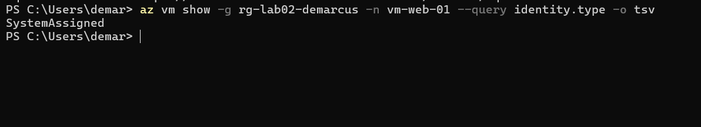

## Step 8: Let the web server read secrets

**What this step does.** It gives that identity permission to read secrets and nothing else.

**What to do.** Start from the Key Vault, not from the virtual machine. In the Key Vault, open **Access control (IAM)**, click **Add**, then **Add role assignment**. On the Role tab pick **Key Vault Secrets User**. If you search, try the short text `secrets user`.

The roles the picker lists depend on where you start. From the virtual machine's own Access control (IAM) page, Key Vault Secrets User was not in the list. From the vault's page it was.

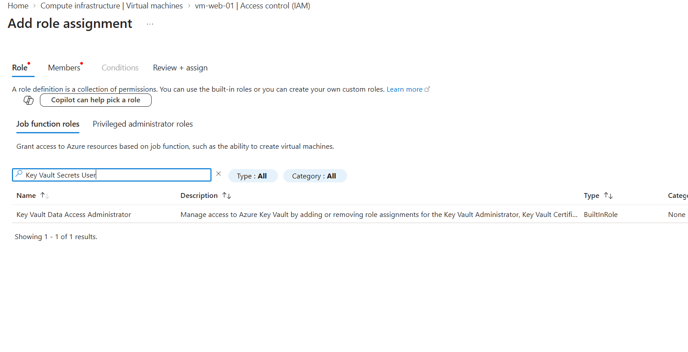

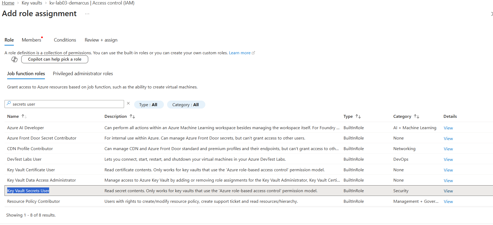

On the Members tab choose **Managed identity**, click **Select members**, set the managed identity type to **Virtual machine**, and select `vm-web-01`. Complete **Review + assign** twice.

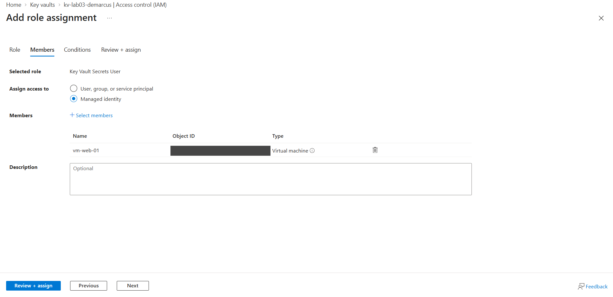

If `vm-web-01` is not in the list, go back to Step 7 and check that the identity saved. Wait a minute and try again.

**What you should see.** On the **Role assignments** tab, `vm-web-01` appears with the role **Key Vault Secrets User** and the type **Virtual machine**. This role can read secret values. It cannot create, change or delete them.

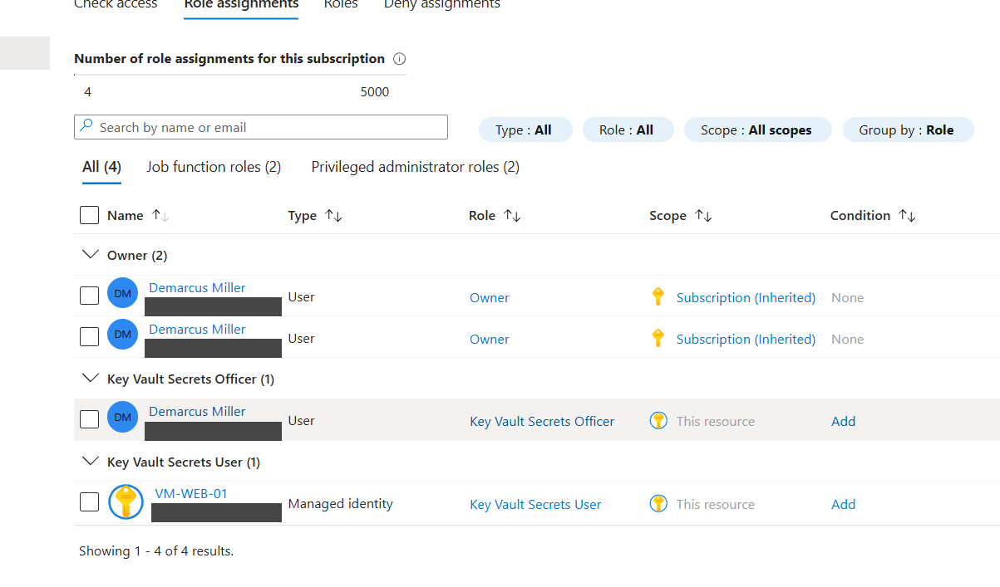

## Step 9: Prove the web server can read the secret

**What this step does.** It tests the whole idea. The web server asks Azure for a token using only its identity, then uses the token to ask Key Vault for the secret. No password is typed.

**What to do.** Connect to the web server over SSH, as you did in Lab 02. Then run these two commands on the web server. The first asks the local Instance Metadata Service for a token and keeps it in a variable:

```bash
TOKEN=$(curl -s -H Metadata:true "http://169.254.169.254/metadata/identity/oauth2/token?api-version=2018-02-01&resource=https://vault.azure.net" | python3 -c "import sys, json; print(json.load(sys.stdin)['access_token'])")
```

It prints nothing when it works.

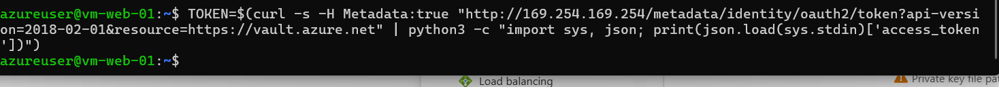

The second sends the token to the vault. It throws away the response body, so the password is not printed. It prints only the HTTP status code:

```bash
curl -s -o /dev/null -w "%{http_code}\n" -H "Authorization: Bearer $TOKEN" "https://kv-lab03-<yourname>.vault.azure.net/secrets/SqlAdminPassword?api-version=7.4"
```

**What you should see.** `200`, which means the request worked. A `403` means the vault refused the identity. Check that the Step 8 assignment is saved and wait a few minutes, since new role assignments can take time to apply. In the test run it printed `200` on the first try.

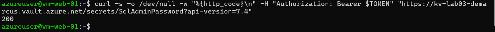

## Step 10: Look at the database in Azure Monitor

**What this step does.** It shows the database is alive and being monitored.

**What to do.** In the portal, open `sqldb-app` from **SQL databases**. If you only see the server, open the server first and then **SQL databases** in the left menu. Open **Monitoring**, then **Metrics**. Choose the metric **DTU percentage** with the aggregation **Max**.

**What you should see.** A chart with a line near zero. A new database can take a few minutes to show data. If the metric list has no DTU percentage, the database is on a serverless tier. Use **CPU percentage** instead.

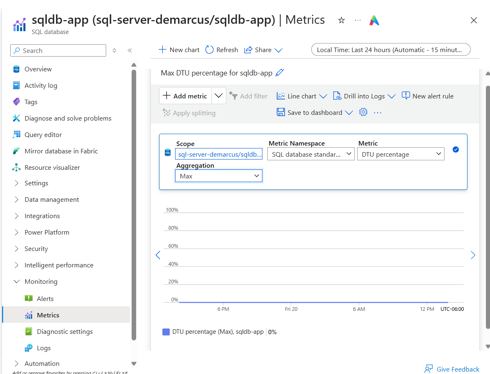

## Step 11: Tear it down

**What this step does.** It removes everything this lab created. Deleting the resource group deletes the SQL server, the database and the Key Vault. There is no undo.

**What to do.** In the portal, open **Resource groups**, open `rg-lab03-<yourname>`, click **Delete resource group**. The panel lists everything that will be deleted: the Key Vault, the SQL server, and two databases, `master` and `sqldb-app`. The `master` database is the SQL server's built-in system database.

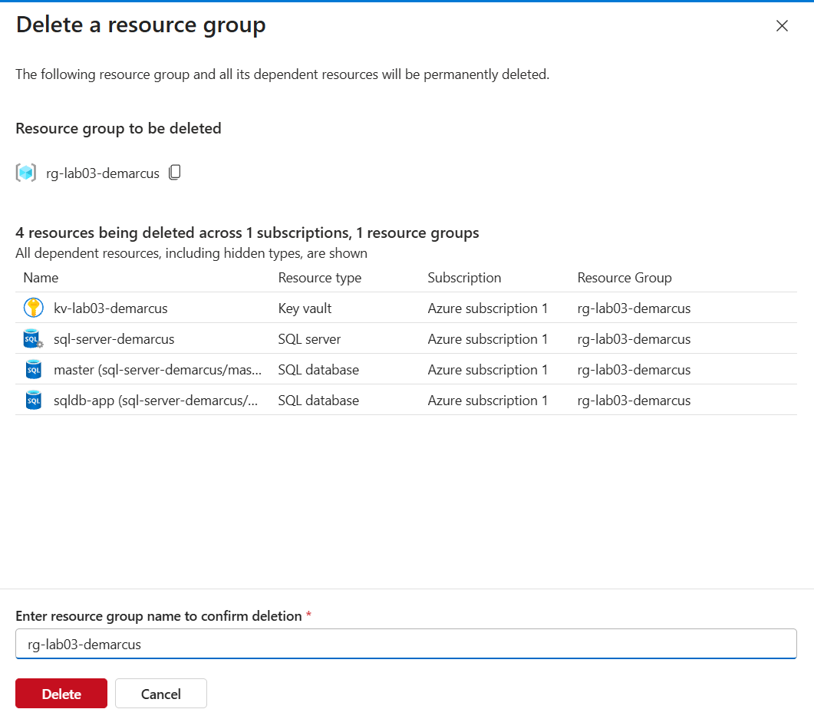

Type the name to confirm and click **Delete**. If you are also finished with Lab 02, delete `rg-lab02-<yourname>` the same way. Then check from the terminal:

```powershell
az group exists -n rg-lab03-<yourname>
az keyvault list-deleted -o table
```

**What you should see.** `az group exists` prints `false`.

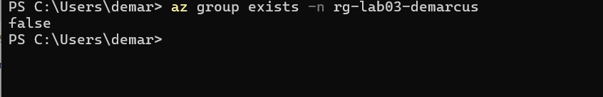

The deleted vault shows in the second list, because Key Vault keeps a deleted vault for a retention period and holds its name.

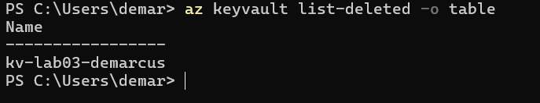

To free the name now, purge it. Purging is permanent. It destroys the vault and the secret in it. You can do it only because purge protection was left disabled in Step 4:

```powershell
az keyvault purge --name kv-lab03-<yourname>
```

The purge prints nothing.

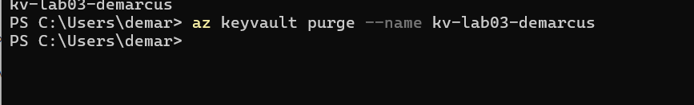

Run `az keyvault list-deleted -o table` again. The list is empty and the name is free.

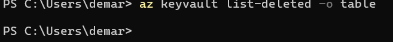

## Troubleshooting

| Problem | What to check |
|---|---|
| SQL database creation fails | The server name is probably taken. Add digits to `sql-server-<yourname>`. |
| The database is on a serverless tier | Compute + storage starts on General Purpose Serverless. Before you click Create, open **Configure database**, choose DTU-based and select Basic. If the database is already created on serverless, use CPU percentage in Step 10. |
| The database has the wrong name | Azure cannot rename a database. Delete it, create a new one on the existing server, and name it `sqldb-app`. |
| "You are unauthorized to view these contents" on Secrets | Your own account has no role on the vault. Do Step 5 and wait a minute or two. |
| `vm-web-01` is missing from the role assignment picker | Check the identity saved in Step 7, wait a minute, and try again. |
| Key Vault Secrets User is missing from the role list | You started from the virtual machine's Access control (IAM). Start from the Key Vault's page instead, as in Step 8. |
| You cannot create the secret in Step 6 | Check which role you gave yourself in Step 5. Key Vault Secrets User only reads secret values. Use Key Vault Secrets Officer. |
| Step 9 prints `403` | The role assignment is missing or has not applied yet. Check Step 8 and wait a few minutes. |
| Step 9 prints nothing, or the token command fails | The managed identity is not on. Check Step 7. |
| The Key Vault name is taken after you deleted it | The deleted vault still holds the name. Purge it with the command in Step 11. |
| The Metrics chart has no data | A new database can take a few minutes to report. Wait and refresh. |
| The Metric dropdown says "We are sorry, we are not able to retrieve these" | Wait a few minutes and open the dropdown again. In the test run it cleared on its own. The cause was not found. |

## What this lab does not do

- It does not connect from the web server to the database. Step 9 proves the web server can read the password. Nothing here opens a SQL connection with it.
- It does not move any data. The database server in Lab 02 held none, and `sqldb-app` starts empty.
- It does not lock down the network. The SQL server has a public endpoint, and **Allow Azure services and resources to access this server** opens its firewall to addresses inside Azure that are not yours. The Key Vault accepts requests from every network, and role-based access is the only control. A production setup would use private endpoints and restrict both.
- It does not use Microsoft Entra authentication for the database. The admin login is a SQL password.
